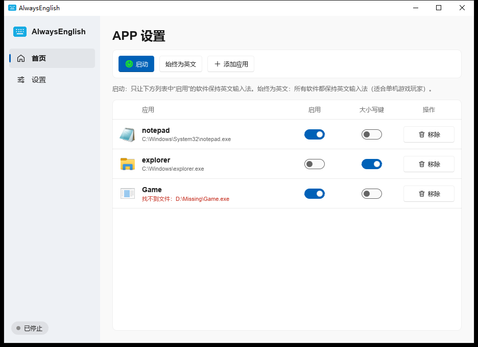
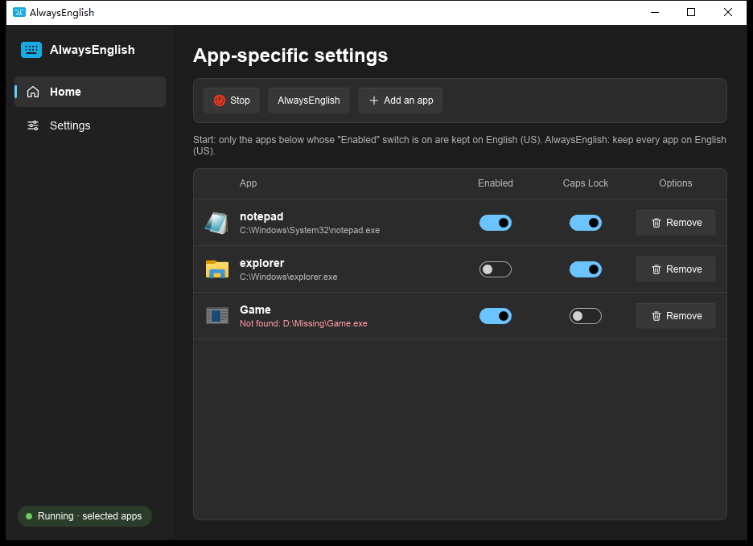

<div align="center">
  

# AlwaysEnglish · Rust + Slint 版

让指定的软件**始终保持英文输入法**（English (US) 键盘），从此不再担心误触切换输入法！

[原项目](https://github.com/ChaXxl/AlwaysEnglish) · [English](#english)

<a href="https://slint.dev"></a>

</div>

> 本项目是 **[ChaXxl/AlwaysEnglish](https://github.com/ChaXxl/AlwaysEnglish)** 的 Rust + Slint 重写版。
> 功能设计、界面布局、交互方式和中文翻译都来自原项目，这里只是换成了 Rust 来实现，并补上了一些原来没有的功能。

## 🙏 致谢

- 首先感谢 **[@ChaXxl](https://github.com/ChaXxl)** 和原项目 [AlwaysEnglish](https://github.com/ChaXxl/AlwaysEnglish)。没有原作者的创意和最初的实现，就不会有这个版本。如果这个工具对你有帮助，也请去给原项目点个 ⭐。
- 原项目的界面基于 [FluentUI for QML](https://github.com/zhuzichu520/FluentUI)（作者 [@zhuzichu520](https://github.com/zhuzichu520)），本版本的界面风格也参考了它。
- 界面使用 [Slint](https://slint.dev) 实现，Windows API 调用使用 [windows-rs](https://github.com/microsoft/windows-rs)。

## 截图

| 浅色 · 中文 | 深色 · English |
| --- | --- |
|  |  |

## 功能

- **启动（指定软件）**：只让列表里“启用”的软件保持英文输入法，每个软件可以单独设置是否强制打开大小写键。
- **始终为英文（所有软件）**：无论前台是什么软件都保持英文输入法（适合单机游戏玩家）。
- 把 `.exe` 或快捷方式（`.lnk`）**拖进窗口**即可添加，也可以点“添加应用”选择。
- 系统托盘：左键打开窗口，右键菜单可以直接切换模式或退出。
- 开机自启动（启动后隐藏在托盘中）、浅色 / 深色 / 跟随系统主题、中文 / English 界面。
- 系统没有安装美式英文键盘时会给出提示，并可一键跳转到 Windows 语言设置。

### 和原版相比的变化

| | 原版（Qt + QML） | 本版本（Rust + Slint） |
| --- | --- | --- |
| **单实例** | 无，可以同时打开多个，多个定时器会互相抢着切换 | 只运行一个实例；再次打开时会把已运行的窗口（包括隐藏在托盘里的）调到前台 |
| 软件匹配 | 子串匹配（`a.exe` 可能误匹配路径里含 `a` 的软件） | 按 exe 文件名精确匹配（不区分大小写） |
| 快捷方式解析 | 返回 8.3 短路径，可能匹配失败 | 返回完整长路径 |
| 定时检查 | 每 100 ms 新建一个 JS 引擎解析 JSON 配置 | 规则保存在内存中，只在修改时更新 |
| 开机自启后 | 需要手动点“启动” | 可自动恢复上次的运行状态（可在设置中关闭） |
| 关闭按钮 | 每次询问 | 每次询问 / 最小化到托盘 / 退出，可以记住选择 |
| 发布体积 | Qt 运行库 + QML 插件，几十 MB | 单个 exe，约 9 MB，无需安装运行库 |

新添加软件的“大小写键”开关默认是**关闭**的（原版默认打开）；从原版迁移过来的设置保持原样。

## 下载与使用

1. 按下面的“编译”一节生成 `AlwaysEnglish.exe`（单个文件，无需安装；发布后也可以从 [Releases](https://github.com/just-liuyi/AlwaysEnglish-rs/releases) 下载）。
2. 运行后，把需要保持英文的软件（或它的快捷方式）拖进列表。
3. 点击 **启动**。如果想让所有软件都保持英文，点击 **始终为英文**。

需要 Windows 10 / 11，并且系统里装有 **英语（美国）** 键盘布局。

### 配置文件

配置保存在 `%LOCALAPPDATA%\AlwaysEnglish\config.json`。第一次启动时，如果检测到原版留下的 `%LOCALAPPDATA%\AlwaysEnglish\AlwaysEnglish.ini`，会自动导入软件列表、主题、大小写键和开机自启动设置。

可以用环境变量 `ALWAYSENGLISH_CONFIG_DIR` 指定其他配置目录（方便测试或便携使用）。

## 编译

需要 [Rust](https://rustup.rs)（stable，MSVC 工具链）。

```shell
git clone https://github.com/just-liuyi/AlwaysEnglish-rs.git
cd AlwaysEnglish-rs
cargo build --release
# 生成 target\release\AlwaysEnglish.exe
cargo test
```

### 目录结构

```
ui/app.slint           界面（主窗口、托盘图标与菜单）
lang/zh_CN/...         简体中文翻译（gettext .po，编译时打包进程序）
src/main.rs            程序入口，把界面和逻辑连接起来
src/engine.rs          每 100 ms 检查前台窗口并切换输入法（对应原版的 ControlInputLayout）
src/platform.rs        Win32 封装：键盘布局、Caps Lock、进程路径、快捷方式、开机自启
src/icons.rs           提取 exe 图标
src/single_instance.rs 单实例：命名互斥体 + 命名管道
src/config.rs          配置读写
src/legacy.rs          导入原版的 QSettings INI 配置
```

### 工作原理

和原版一样：定时获取前台窗口所属线程的键盘布局，如果不是英语（美国，`0x0409`），就向该窗口发送 `WM_INPUTLANGCHANGEREQUEST` 请求切换；需要时再模拟按下 Caps Lock。

单实例：启动时创建 `Local\AlwaysEnglish-rs-<会话>-<用户>` 命名互斥体。如果它已经存在，新进程会通过命名管道通知已运行的实例显示窗口，调用 `AllowSetForegroundWindow` 允许它切到前台，然后自己退出。

## 相关资料

- [Windows 键盘布局标识符](https://www.science.co.il/language/Locale-codes.php)
- [MS-LCID](https://learn.microsoft.com/en-us/openspecs/windows_protocols/ms-lcid/70feba9f-294e-491e-b6eb-56532684c37f)

## 许可证

[Apache License 2.0](LICENSE)，与原项目相同。原项目的署名以及本版本做了哪些修改，见 [NOTICE](NOTICE)。

---

## English

**AlwaysEnglish** keeps chosen Windows apps on the English (US) keyboard layout, so an accidental hotkey can no longer switch them to another input method. This is a Rust + [Slint](https://slint.dev) rewrite of [ChaXxl/AlwaysEnglish](https://github.com/ChaXxl/AlwaysEnglish). Many thanks to [@ChaXxl](https://github.com/ChaXxl) for the original project, and to [FluentUI for QML](https://github.com/zhuzichu520/FluentUI), which the original UI was built on.

What changed compared with the original: the app now runs as a single instance (launching it again brings the running window to the front), apps are matched by exact executable name, the last mode can be resumed on launch, the close button behaviour is configurable, the tray menu can switch modes, settings from the Qt version are imported, and the release is a single ~9 MB executable.

Build with `cargo build --release`. Licensed under Apache-2.0, like the original; see [NOTICE](NOTICE).
